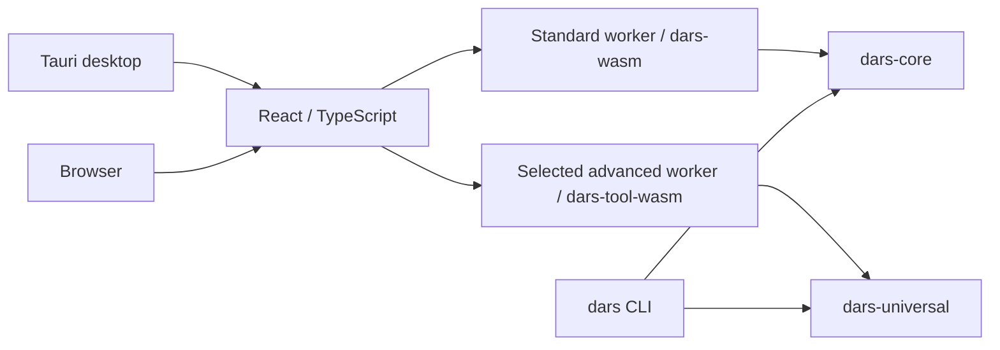

# DARS architecture

[Português brasileiro](../pt-BR/architecture.md)

The monorepo shares each Rust evaluator across the web interface, the native desktop shell and the CLI. The interface owns editing and presentation. Rust owns parsing, domains, mathematical results and errors.



## Components

| Path | Responsibility |
| --- | --- |
| `crates/dars-core` | Bounded parser, structured evaluation, exact and approximate numeric representations, stable errors |
| `crates/dars-wasm` | WebAssembly export for the Rust evaluator |
| `crates/dars-universal` | Bounded advanced evaluators and shared calculation record envelope |
| `crates/dars-tool-wasm` | Separately built WebAssembly target for each advanced workspace |
| `crates/dars-cli` | One-shot native command-line evaluation |
| `apps/web` | Registry and controls for ten workspaces, editing, temporary state, localization and result presentation |
| `apps/desktop` | Tauri window and embedded Vite build, with the same WASM evaluator as the browser |
| `tests/` and `benchmarks/` | Independent reference checks and reproducible measurements |

## Evaluation interface

The CLI and the basic Wasm `evaluate_json` export accept a canonical expression string and return one of two JSON objects.

```json
{"ok":true,"exact":"3/10","approximate":"0.3"}
```

```json
{"ok":false,"code":"division_by_zero"}
```

An exact result uses a reduced rational string or an integer string. Approximate-only results have a null `exact` field. Numerical fields are strings, so calculation never depends on JavaScript's floating-point conversion. The UI is responsible for localized display. Stable error codes let different clients report the same mathematical failure in their own language.

The Standard worker uses `evaluate_value_json(expression, bindings_json)` and `combine_values_json(left, right, subtract)`. Successful responses add a `value` string containing an opaque Rust representation of a reduced rational or a certified interval with rational endpoints. The UI passes it back unchanged for memory arithmetic and session references. This preserves the original numeric value when the displayed decimal rounds and keeps `%` interpretation inside expression evaluation. An empty left value in `combine_values_json` represents zero. Both exports use the same stable error response.

For an expression containing `@n` references, the UI supplies only the values referenced by that expression. The binding object has at most 256 entries with positive canonical 32-bit unsigned integer keys. Each stored value is limited to 10,000 bytes and the binding JSON is limited to 2,565,122 bytes. The opt-in `standard-record` CLI operation accepts explicit bindings from a record. The standard one-argument CLI evaluates an expression without session state. [Calculation record contract](../../evidence/objective-03/calculation-proof/contract.md)

## Worker lifecycle

The adapter dispatches one request at a time after the worker signals readiness, with at most eight active and queued requests in total. Worker startup has a 15-second deadline, and a dispatched request has a five-second deadline. Cancelling a queued request removes it from the queue. Cancelling an active request terminates its worker and starts a replacement. Replies from a superseded worker cannot settle current work.

Startup failures, worker faults, malformed responses and timeouts trigger recovery. The adapter can make two consecutive automatic retries, each after 250 ms. A valid job response resets that retry count. When retries are exhausted, the engine reports that it is unavailable and reload can start it again. Standard checks whether a pending operation still belongs to the current expression before updating the result or memory. It also checks whether history was cleared since dispatch before adding an entry.

Evaluators are isolated from I/O and the host environment. Each workspace receives a narrow evaluation adapter and owns its session-local state. An advanced workspace loads its own WASM and retires its dedicated worker after completion or cancellation. The selected workspace may retain its draft across suspension, within session memory limits. [Workspace verification](../../evidence/objective-03/PLAN.md)

See [Standard calculation semantics](standard.md) for the expression grammar, rounding, and resource bounds. See [ADR 001](../adr/0001-shared-calculation-core.md) for the architectural decision.

Objective 02 documents activation scopes, worker retirement and the data boundary. [Operational contract](operations.md)
