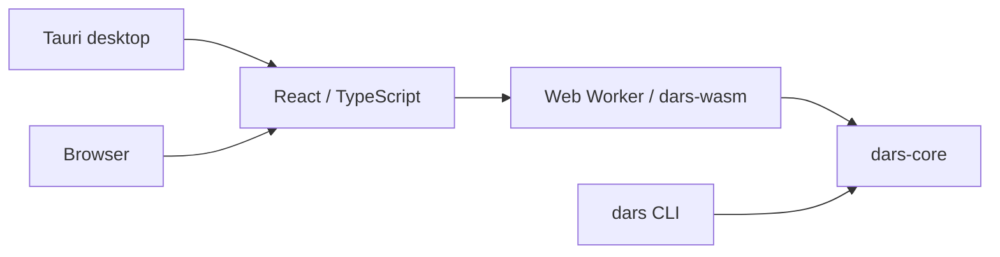

# Foundation architecture

[Português brasileiro](../pt-BR/architecture.md)

The monorepo shares one evaluator across the web interface, the native desktop shell, and the CLI. The user interface owns editing and presentation. The engine owns parsing, domains, numeric results and errors.



## Components

| Path | Responsibility |
| --- | --- |
| `crates/dars-core` | Bounded parser, structured evaluation, exact and approximate numeric representations, stable errors |
| `crates/dars-wasm` | WebAssembly export for the Rust evaluator |
| `crates/dars-cli` | One-shot native command-line evaluation |
| `apps/web` | Module registry, Standard controls, editing, temporary state, localization and result presentation |
| `apps/desktop` | Tauri window and embedded Vite build, with the same WASM evaluator as the browser |
| `tests/` and `benchmarks/` | Independent reference checks and reproducible measurements |

## Evaluation interface

The boundary accepts a canonical expression string and returns one of two JSON objects.

```json
{"ok":true,"exact":"3/10","approximate":"0.3"}
```

```json
{"ok":false,"code":"division_by_zero"}
```

An exact result uses a reduced rational string or an integer string. Approximate-only results have a null `exact` field. Numerical fields are strings, so calculation never depends on JavaScript's floating-point conversion. The UI is responsible for localized display. Stable error codes let different clients report the same mathematical failure in their own language.

The engine is isolated from I/O and the host environment. Modules receive a narrow evaluation adapter. Standard uses the shared Rust evaluator and owns session-local state. Future modules can introduce different contracts at their own boundaries. Runtime lifecycle optimization belongs to Objective 02.

See [Standard calculation semantics](standard.md) for the expression grammar, rounding, and resource bounds. See [ADR 001](../adr/0001-shared-calculation-core.md) for the architectural decision.
