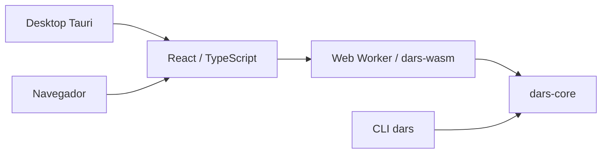

# Arquitetura da fundação

[English](../en/architecture.md)

O monorepo compartilha um único avaliador entre a interface web, a janela desktop nativa e a CLI. A interface controla edição e apresentação. O núcleo controla análise sintática, domínios, resultados numéricos e erros.



## Componentes

| Caminho | Responsabilidade |
| --- | --- |
| `crates/dars-core` | Parser com limites, avaliação estruturada, representações numéricas exatas e aproximadas e erros estáveis |
| `crates/dars-wasm` | Exportação WebAssembly do avaliador em Rust |
| `crates/dars-cli` | Avaliação nativa pontual pela linha de comando |
| `apps/web` | Catálogo de módulos, controles do Standard, edição, estado temporário, localização e apresentação de resultados |
| `apps/desktop` | Janela Tauri com o build Vite incorporado e o mesmo avaliador WASM do navegador |
| `tests/` e `benchmarks/` | Verificações com referências independentes e medições reproduzíveis |

## Interface de avaliação

A interface recebe uma expressão como texto canônico e retorna um de dois objetos JSON.

```json
{"ok":true,"exact":"3/10","approximate":"0.3"}
```

```json
{"ok":false,"code":"division_by_zero"}
```

O resultado exato usa uma fração irredutível ou um inteiro em formato textual. Resultados apenas aproximados têm o campo `exact` nulo. Campos numéricos usam texto, de modo que o cálculo jamais depende da conversão para ponto flutuante do JavaScript. A apresentação localizada fica com a interface. Códigos de erro estáveis permitem que cada ambiente descreva a mesma falha matemática em seu idioma.

O núcleo fica isolado de operações de entrada e saída e do ambiente hospedeiro. Cada módulo recebe uma interface de avaliação restrita. O Standard usa o avaliador compartilhado em Rust e controla seu estado temporário. Módulos futuros podem adotar contratos próprios nos respectivos limites. A otimização do ciclo de vida em execução pertence ao Objetivo 02.

Veja a gramática das expressões, o arredondamento e os limites de recursos na [semântica dos cálculos Standard](standard.md). A decisão de arquitetura está no [ADR 001](../adr/0001-shared-calculation-core.md).
