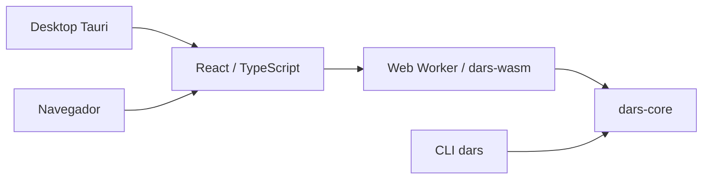

# Arquitetura da fundação

[English](../en/architecture.md)

O monorepo compartilha um único avaliador entre a interface web, a janela desktop nativa e a CLI. A interface controla edição e apresentação. O núcleo controla análise sintática, domínios, resultados numéricos e erros.



## Componentes

| Caminho | Responsabilidade |
| --- | --- |
| `crates/dars-core` | Parser com limites, avaliação estruturada, representações numéricas exatas e aproximadas e erros estáveis |
| `crates/dars-wasm` | Exportação WebAssembly do avaliador em Rust |
| `crates/dars-cli` | Avaliação nativa pontual pela linha de comando |
| `apps/web` | Catálogo de módulos, controles do Standard, edição, estado temporário, localização e apresentação de resultados |
| `apps/desktop` | Janela Tauri com o build Vite incorporado e o mesmo avaliador WASM do navegador |
| `tests/` e `benchmarks/` | Verificações com referências independentes e medições reproduzíveis |

## Interface de avaliação

A CLI e a exportação básica Wasm `evaluate_json` recebem uma expressão como texto canônico e retornam um de dois objetos JSON.

```json
{"ok":true,"exact":"3/10","approximate":"0.3"}
```

```json
{"ok":false,"code":"division_by_zero"}
```

O resultado exato usa uma fração irredutível ou um inteiro em formato textual. Resultados apenas aproximados têm o campo `exact` nulo. Campos numéricos usam texto, de modo que o cálculo jamais depende da conversão para ponto flutuante do JavaScript. A apresentação localizada fica com a interface. Códigos de erro estáveis permitem que cada ambiente descreva a mesma falha matemática em seu idioma.

O worker do Standard usa `evaluate_value_json(expression, bindings_json)` e `combine_values_json(left, right, subtract)`. Respostas bem-sucedidas incluem também `value`, um texto opaco produzido pelo Rust que representa um racional irredutível ou um intervalo certificado com extremos racionais. A interface devolve esse texto sem alterações nas operações de memória e nas referências da sessão. Isso preserva o valor numérico original quando o decimal exibido é arredondado e mantém a interpretação de `%` no avaliador de expressões. Um valor vazio à esquerda em `combine_values_json` representa zero. As duas exportações usam a mesma resposta de erro estável.

Para uma expressão com referências `@n`, a interface envia somente os valores usados nela. O objeto de referências tem até 256 entradas, com chaves em formato canônico de inteiro positivo de 32 bits sem sinal. Cada valor armazenado tem até 10.000 bytes. O JSON de referências tem até 2.565.122 bytes. A CLI de execução pontual não oferece referências de sessão.

## Ciclo de vida do worker

Após a sinalização de que o worker está pronto, o adaptador envia uma solicitação por vez, com até oito solicitações ativas e em fila no total. O worker tem 15 segundos para iniciar e cada solicitação já enviada tem cinco segundos para terminar. Cancelar uma solicitação em espera a remove da fila. Cancelar uma solicitação ativa encerra seu worker e inicia um substituto. Respostas de um worker substituído não afetam as operações atuais.

Falhas de inicialização ou do worker, respostas malformadas e estouros de prazo acionam a recuperação. O adaptador pode fazer duas novas tentativas automáticas consecutivas, cada uma após 250 ms. Uma resposta válida a uma solicitação zera esse contador. Se as tentativas se esgotarem, o núcleo aparece como indisponível e recarregar permite iniciar o worker novamente. O Standard verifica se uma operação pendente ainda pertence à expressão atual antes de atualizar o resultado ou a memória. Também verifica se o histórico foi limpo após o envio antes de adicionar um item.

O núcleo fica isolado de operações de entrada e saída e do ambiente hospedeiro. Cada módulo recebe uma interface de avaliação restrita. O Standard usa o avaliador compartilhado em Rust e controla seu estado temporário. Módulos futuros podem adotar contratos próprios nos respectivos limites.

Veja a gramática das expressões, o arredondamento e os limites de recursos na [semântica dos cálculos Standard](standard.md). A decisão de arquitetura está no [ADR 001](../adr/0001-shared-calculation-core.md).

O Objetivo 02 documenta os escopos de ativação, o encerramento do worker e as fronteiras de dados. [Contrato operacional](operations.md)
